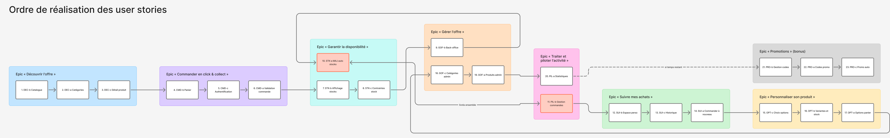
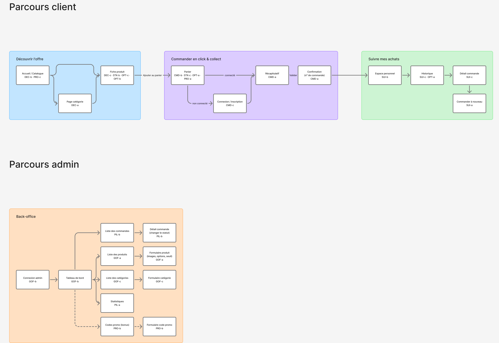
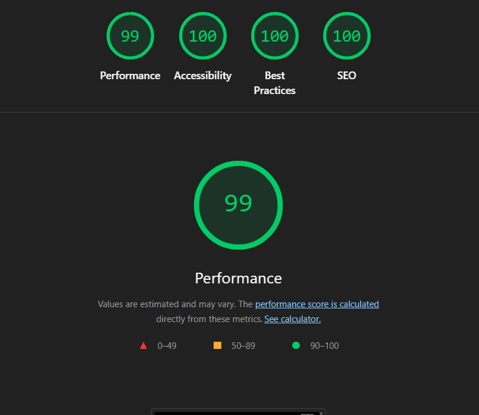

# SAE301 — PlayStation Click & Collect

Boutique click & collect PlayStation (consoles, manettes, jeux, accessoires) :
le client réserve en ligne et retire sa commande en magasin. Projet individuel,
BUT2 MMI.

Site en ligne : <https://mmi.unilim.fr/~hadj-zekri1/SAE301/>

Le dépôt part du starter « catalogue de films » : son architecture et ses
conventions sont gardées, seul le domaine a changé (film → produit). Une API
PHP en trois couches (routage / contrôleur / modèle) au-dessus de MySQL, et un
front en JavaScript vanilla (Vite + Tailwind CSS 4) organisé en layouts, pages
et composants, avec un routeur côté client.

## Fonctionnalités

| Epic | US | Ce que ça fait |
|---|---|---|
| Découvrir l'offre | DEC-b, DEC-a, DEC-c | catalogue, filtre par catégorie (`/categorie/consoles`), fiche produit avec galerie |
| Commander en click & collect | CMD-b, CMD-c, CMD-a | panier, inscription / connexion, validation de la commande avec un numéro de retrait |
| Garantir la disponibilité | STK-b, STK-c, STK-a | état du stock affiché, quantités bornées au stock, stock décrémenté à la commande et recrédité à l'annulation |
| Gérer l'offre | GOF-b, GOF-c, GOF-a | back-office : connexion admin, catégories, produits (images, options, variantes, seuil de stock) |
| Traiter et piloter l'activité | PIL-b, PIL-a | commandes et changement de statut, statistiques |
| Suivre mes achats | SUI-b, SUI-c, SUI-a | espace personnel, historique des commandes, commander à nouveau |
| Personnaliser son produit | OPT-c, OPT-b, OPT-a | choix des options (coloris…), variantes avec leur propre prix et stock, options rappelées dans le panier |
| Promotions (bonus) | PRO-b, PRO-a, PRO-c | gestion des codes promo, code saisi au panier, promotions automatiques |

Les 23 US sont réalisées. Les user stories détaillées sont dans
[`docs/user-stories.md`](docs/user-stories.md), les maquettes dans
[`docs/maquettes.md`](docs/maquettes.md).

## Graphe des dépendances entre user stories

Source : planche FigJam du projet,
<https://www.figma.com/board/degJIK32MAEBn88tAUN3sC/graphe>.



Lecture du graphe :

- une flèche va d'une US vers celle qui en dépend : la seconde ne peut pas
  être terminée sans la première ;
- le numéro devant chaque US donne l'ordre de réalisation ;
- la flèche pointillée signifie « si le temps le permet » (epic Promotions) ;
- les deux US en rouge (STK-a et PIL-b) sont livrées ensemble : la flèche à
  double sens indique que chacune a besoin de l'autre.

Les mêmes US placées sur les écrans qu'elles concernent :



## Ordre de réalisation retenu

| N° | US | N° | US | N° | US |
|---|---|---|---|---|---|
| 1 | DEC-b Catalogue | 9 | GOF-b Back-office | 17 | OPT-a Options panier |
| 2 | DEC-a Catégories | 10 | STK-a Mise à jour auto des stocks | 18 | GOF-c Catégories admin |
| 3 | DEC-c Détail produit | 11 | PIL-b Gestion commandes | 19 | GOF-a Produits admin |
| 4 | CMD-b Panier | 12 | SUI-b Espace personnel | 20 | PIL-a Statistiques |
| 5 | CMD-c Authentification | 13 | SUI-c Historique | 21 | PRO-b Gestion des codes |
| 6 | CMD-a Validation commande | 14 | SUI-a Commander à nouveau | 22 | PRO-a Codes promo |
| 7 | STK-b Affichage stocks | 15 | OPT-c Choix options | 23 | PRO-c Promotions auto |
| 8 | STK-c Contraintes stock | 16 | OPT-b Variantes et stock | | |

### Justification

- **Le cœur d'abord : catalogue, panier, commande.** Sans produits à
  afficher, rien d'autre ne se teste. CMD-a est le pivot du projet : 7 US en
  dépendent (stock, back-office des commandes, historique, statistiques…).
- **Le stock juste après la commande.** On sécurise l'achat (pas de vente
  au-delà du stock) avant d'ouvrir l'espace client.
- **GOF-b avancé en 9.** Sans back-office, impossible d'annuler une commande,
  donc de tester le recrédit du stock prévu par STK-a.
- **STK-a et PIL-b livrées ensemble.** Le changement de statut d'une commande
  (PIL-b) déclenche la mise à jour du stock (STK-a) : chacune a besoin de
  l'autre pour être terminée.
- **Les variantes prévues dès DEC-b.** Chaque produit a une variante par
  défaut dès le départ, qui porte le prix et le stock. L'epic Options peut donc
  venir après STK et SUI sans réécrire le panier ni la commande.
- **GOF-c et GOF-a après les options.** L'administration des produits gère
  directement les options et les variantes, au lieu d'être refaite ensuite.
- **Ligne de coupure si le temps manque** : d'abord les Promotions (bonus),
  puis PIL-a, puis GOF-a et GOF-c. Les promotions n'ont été commencées qu'une
  fois les 20 premières US terminées.

### Écarts avec l'ordre prévu

L'historique git suit cet ordre à trois exceptions près, sans conséquence sur
les dépendances :

- DEC-c a été fusionnée avant DEC-a : la fiche produit ne dépend que du
  catalogue ;
- STK-a a été fusionnée avant GOF-b, l'annulation (et donc le recrédit) étant
  ensuite testée avec le back-office ;
- GOF-c a été faite juste après GOF-b, avant PIL-b, la gestion des catégories
  étant indépendante des commandes.

## Arborescence

```
.htaccess              /api/... vers le back, images téléversées vers uploads/, le reste vers front/dist/
sql/import.sql         schéma complet et données de départ
uploads/produits/      images téléversées depuis le back-office (non versionnées)
docs/                  user stories, maquettes, graphe des dépendances
back/                  API PHP 8, ne renvoie que du JSON
├── index.php          point d'entrée : assemble modèles et contrôleurs, délègue au routeur
├── config/            identifiants de la base, chemin du projet, debug
└── src/               Core/ (Request, Response, Router, Database),
                       Controller/, Model/, routes.php
front/                 sources du front (Vite + Tailwind CSS 4)
├── index.html         page unique de l'application
├── vite.config.js     chemin du projet, proxy de développement
├── src/
│   ├── main.js        déclaration des layouts et des routes
│   ├── global.css     Tailwind : couleurs, typographie, utilitaires
│   ├── layouts/       site client (header + page + footer) et back-office
│   ├── pages/         une page par route : page.js + template.html
│   ├── ui/            composants réutilisables : index.js + template.html
│   ├── data/          appels à l'API (un module par ressource), panier
│   └── lib/           routeur, rendu des templates, requêtes, formats
├── tests/             tests Playwright, un dossier par epic, un fichier par US
└── dist/              résultat de npm run build (non versionné)
```

## Installation

1. Importez `sql/import.sql` dans votre base depuis phpMyAdmin. Il crée toutes
   les tables et les données de départ ; **une table existante de même nom
   est remplacée**, avec ses données.
2. Dans `back/config/config.php`, renseignez les identifiants de la base et
   le chemin du projet (`/~votre_login/SAE301/`).
3. Dans `front/vite.config.js`, donnez à `BASE` **exactement** le même chemin.
4. Donnez au serveur web le droit d'écrire dans `uploads/produits/` (images
   téléversées depuis le back-office).
5. Dans `front/`, installez les dépendances :

```bash
npm install
```

## Développer

```bash
npm run dev
```

Le front est servi par Vite à `http://localhost:5173/~votre_login/SAE301/`.
Les requêtes `/api/...` et les images téléversées sont relayées par Vite vers
le serveur `mmi.unilim.fr` : le back doit donc être en place sur le serveur.
Utilisez Chrome ou Firefox (cookies `Secure`).

## Déployer

```bash
npm run build
```

Le front compilé est produit dans `front/dist/`. Le `.htaccess` sert ses
fichiers et répond par `front/dist/index.html` à toute autre adresse
(`/panier`, `/admin`…) : c'est le routeur du front qui affiche la bonne page,
ou la page 404.

## Architecture

Le parcours d'une requête :

1. le navigateur charge la page unique ; `main.js` lit la session, puis le
   routeur choisit le layout (`/` ou `/admin`) et la page de l'adresse ;
2. la page appelle un module de `data/`, qui appelle l'API par
   `lib/api-request.js` (seul endroit où l'on appelle `fetch`) ;
3. `/api/...` arrive dans `back/index.php` → `routes.php` → contrôleur
   (validation, droits) → modèle (requêtes SQL préparées) → réponse JSON ;
4. la page range la réponse dans son état `M`, puis `V` reconstruit toute la
   page ; les composants de `ui/` reçoivent leurs données et signalent les
   actions de l'utilisateur.

Choix du domaine :

- **Catalogue** : `categorie` → `produit` → `variante` (prix, stock). Les
  options (Coloris : Noir…) sont génériques : `option_produit`,
  `valeur_option`, `variante_valeur`. Le stock n'est jamais envoyé au
  navigateur, seulement un état : `en_stock`, `bientot_epuise` ou `epuise`.
- **Panier** : uniquement dans le `localStorage`, sans prix
  (`{ variantId, quantite }`). Le serveur recalcule prix et totaux, et ramène
  les quantités au stock disponible.
- **Commande** : nom, options et prix unitaire figés dans chaque ligne. Le
  stock est vérifié et décrémenté dans la même transaction, et journalisé.
  Statuts : `en_cours` → `disponible` → `retiree`, ou `annulee`.
- **Comptes** : rôles `client` et `admin`, avec deux sessions séparées : se
  déconnecter de la boutique ne ferme pas le back-office.

## L'API

| Domaine | Routes |
|---|---|
| Catalogue | `GET /api/produits`, `GET /api/produit?slug=`, `GET /api/categories` |
| Panier, commande | `POST /api/panier`, `POST /api/commande`, `GET /api/commande?numero=` |
| Compte client | `POST /api/login`, `POST /api/logout`, `POST /api/inscription`, `GET /api/session`, `GET /api/compte`, `GET /api/compte/commandes`, `POST /api/compte/profil` |
| Back-office | `POST /api/admin/login`, `POST /api/admin/logout`, `GET /api/admin/tableau-de-bord`, commandes, produits, catégories, statistiques, codes promo, seuil de stock |

La liste exacte est dans `back/src/routes.php`. Les écritures sont en
`POST /api/<ressource>/<action>` ; aucun paramètre dans le chemin.

| Code | Signification |
|---|---|
| 403 | non connecté, ou pas les droits |
| 422 | saisie invalide, identifiants faux |
| 404 | ressource introuvable |
| 409 | conflit : stock insuffisant, doublon |
| 400 | paramètre d'adresse manquant ou invalide |

L'API ne répond jamais 401 : l'espace web est derrière l'authentification
HTTP d'Apache, et un 401 ferait redemander les identifiants de l'IUT.

## Comptes de démonstration

| E-mail | Mot de passe | Rôle |
|---|---|---|
| `client@playstation.test` | `client1234` | `client` (boutique) |
| `admin@playstation.test` | `admin1234` | `admin` (back-office, `/admin`) |

## Tests

Tests Playwright de bout en bout, dans `front/tests/<epic>/<us>.spec.js` : un
test par point de la Definition of Done (spécifique et commune) et par critère
d'acceptation. Ils valident aussi le HTML et le CSS au validateur W3C.

```bash
npm test                # tests en lecture seule, Chromium et Firefox
npm run test:ecriture   # tests qui créent puis suppriment leurs données (préfixe e2e)
npm run test:rapport    # rapport du dernier lancement
```

## Performances

Audit Lighthouse du site déployé : 99 en performance, 100 en accessibilité,
bonnes pratiques et SEO. Les polices SST sont servies en WOFF2, les images
produits en miniatures WebP (320 et 640 px), et le `.htaccess` fixe la durée
de cache des fichiers (un an pour les scripts et feuilles de style du build,
un mois pour les images et les polices).



Rapports Lighthouse complets : [mobile](docs/audit-mobile.html) et
[desktop](docs/audit-desktop.html) (à ouvrir dans un navigateur).

## Si ça ne marche pas

| Symptôme | Cause probable |
|---|---|
| Un listing de dossiers, ou une erreur 404 sur la racine | le `.htaccess` n'a pas été déposé, ou `front/dist/` est absent (lancer `npm run build`) |
| Page blanche, fichiers `assets/…` en 404 | `BASE` de `vite.config.js` ne correspond pas au dossier de dépôt |
| « Impossible de charger le catalogue » | identifiants de `config.php`, ou tables non importées |
| La connexion ne tient pas | `chemin` de `config.php` ne correspond pas au dossier de dépôt |
| L'envoi d'une image échoue dans le back-office | `uploads/produits/` n'est pas accessible en écriture |
| En développement, l'API répond 404 | le back n'est pas déployé sur le serveur, ou `BASE` est faux |
